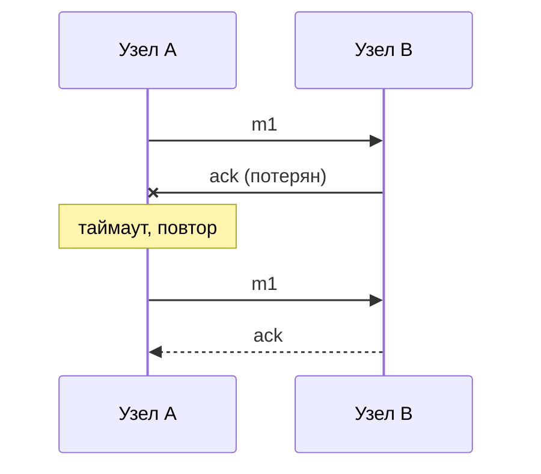
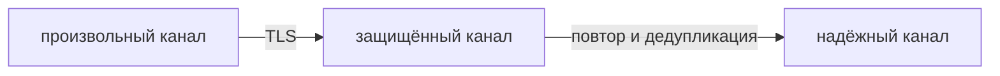

Эта страница — образец. На ней собраны все приёмы вёрстки, которые понимает сайт: по ней видно, не сломалась ли вёрстка, и сюда удобно подсматривать, когда пишешь. У каждого приёма сначала исходник, как его набирать в Obsidian, потом результат.

## Текст

~~~markdown
*Курсив*, **жирный**, ~~зачёркнутый~~, ==выделение==, `код в строке`.
Цена 100 $: между числом и знаком неразрывный пробел (⌥Пробел), чтобы строка не рвалась.
~~~

*Курсив*, **жирный**, ~~зачёркнутый~~, ==выделение==, `код в строке`.
Цена 100 $: между числом и знаком неразрывный пробел (⌥Пробел), чтобы строка не рвалась.

### Заголовок третьего уровня

#### Заголовок четвёртого уровня

Заголовки второго и третьего уровня попадают в оглавление справа. Первый уровень на странице один — это название, его ставит сайт.

## Ссылки

~~~markdown
На заметку: [[raspredelennye-sistemy|распределённые системы]].
На раздел заметки: [[modelirovanie-raspredelennyh-sistem#Поведение сети|поведение сети]].
Наружу: [статья Лэмпорта](https://lamport.azurewebsites.net/pubs/time-clocks.pdf).
~~~

На заметку: [[raspredelennye-sistemy|распределённые системы]].
На раздел заметки: [[modelirovanie-raspredelennyh-sistem#Поведение сети|поведение сети]].
Наружу: [статья Лэмпорта](https://lamport.azurewebsites.net/pubs/time-clocks.pdf).

Ссылка на заметку, которой нет на сайте (черновик, приватный файл), на странице становится обычным текстом.

## Сноски

~~~markdown
Часы Лэмпорта упорядочивают события[^lamport], векторные часы
ловят и конкурентность[^vector]. Ещё раз о Лэмпорте[^lamport].

[^lamport]: Leslie Lamport. [Time, Clocks, and the Ordering of Events in a Distributed System](https://lamport.azurewebsites.net/pubs/time-clocks.pdf), 1978.
[^vector]: Сноска может быть и комментарием, без ссылки.
~~~

Часы Лэмпорта упорядочивают события[^lamport], векторные часы ловят и конкурентность[^vector]. Ещё раз о Лэмпорте[^lamport].

Номера сайт ставит сам, по первому упоминанию, — имя в скобках может быть любым. Повторная ссылка на ту же сноску получает тот же номер. Все сноски собираются внизу страницы под заголовком «Примечания». Наведение на номер показывает сноску, на телефоне — касание. В Obsidian сноску ставит команда «Вставить сноску» или набор `[^`.

## Списки

~~~markdown
- пункт
  - вложенный пункт

1. первый
2. второй

- [x] сделано
- [ ] не сделано
~~~

- пункт
  - вложенный пункт

1. первый
2. второй

- [x] сделано
- [ ] не сделано

## Цитата и выноски

~~~markdown
> Обычная цитата.

> [!note] Заметка
> Выноска с заголовком.

> [!warning] Осторожно
> Предупреждение.

> [!tip]- Свёрнутая выноска
> Раскрывается нажатием на заголовок.
~~~

> Обычная цитата.

> [!note] Заметка
> Выноска с заголовком.

> [!warning] Осторожно
> Предупреждение.

> [!tip]- Свёрнутая выноска
> Раскрывается нажатием на заголовок.

Род выноски — слово после `!`: `note`, `tip`, `warning`, `danger`, `example`, `quote`, `question` и другие из Obsidian. Минус после скобок сворачивает выноску.

## Таблица

~~~markdown
| Модель узла | Теряет память | Возвращается |
|:--|:-:|--:|
| crash-stop | да | нет |
| crash-recovery | да | да |
| byzantine | что угодно | что угодно |
~~~

| Модель узла | Теряет память | Возвращается |
|:--|:-:|--:|
| crash-stop | да | нет |
| crash-recovery | да | да |
| byzantine | что угодно | что угодно |

Двоеточия во второй строке выравнивают столбец: слева, по центру, справа.

## Код

~~~markdown
```go
func (c *Clock) Receive(t uint64) uint64 {
	c.t = max(c.t, t) + 1
	return c.t
}
```
~~~

```go
func (c *Clock) Receive(t uint64) uint64 {
	c.t = max(c.t, t) + 1
	return c.t
}
```

## Формулы

~~~markdown
В строке: при получении $t := \max(t, t') + 1$.

Отдельно:

$$
V(a) \le V(b) \iff \forall i:\; V(a)[i] \le V(b)[i]
$$

Несколько строк с выравниванием:

$$
\begin{aligned}
a \parallel b &\iff V(a) \nleq V(b) \land V(b) \nleq V(a) \\
n &\ge 3f + 1
\end{aligned}
$$
~~~

В строке: при получении $t := \max(t, t') + 1$.

Отдельно:

$$
V(a) \le V(b) \iff \forall i:\; V(a)[i] \le V(b)[i]
$$

Несколько строк с выравниванием:

$$
\begin{aligned}
a \parallel b &\iff V(a) \nleq V(b) \land V(b) \nleq V(a) \\
n &\ge 3f + 1
\end{aligned}
$$

Знак `$` открывает формулу, только если за ним сразу идёт не пробел, и закрывает, только если перед ним не пробел. Поэтому `$x$` — формула, а 100 $ — текст. Obsidian рисует формулы MathJax, сайт — KaTeX: обычный набор у них общий, но редкий макрос может разойтись. Широкая формула на телефоне прокручивается в своей рамке.

## Диаграмма последовательности

~~~markdown

~~~


`->>` — сообщение, `-->>` — ответ пунктиром, `-x` — потерянное сообщение, `Note over` — заметка над линией. Стрелки Mermaid всегда горизонтальны и идут по очереди: задержку в пути и пересечение сообщений он не нарисует. Для этого — рисунок ниже.

## Схема

~~~markdown

~~~


## Рисунок Excalidraw

~~~markdown
![[specimen-spacetime.svg|Часы Лэмпорта: три процесса]]
~~~

![[specimen-spacetime.svg|Часы Лэмпорта: три процесса]]

Диаграмма пространства-времени: у каждого процесса своя линия времени, наклон сообщения — его задержка в пути. Сообщения m2 и m3 пересекаются: их отправки конкурентны, хотя метка Лэмпорта у одной меньше, чем у другой.

Рисунок создаёт команда «Сад: Создать диаграмму Excalidraw»: кладёт рисунок рядом с заметкой и вставляет строку `![[…svg|подпись]]` под курсор. Подпись после `|` читают те, кто не видит картинку. На сайт попадают прямоугольник, ромб, эллипс, линия, стрелка, текст и рисунок от руки; текст становится настоящим текстом страницы.

## Рисунок с планшета

~~~markdown
![[specimen-ipad.svg|Зарисовка на iPad: два узла и лямбда]]
~~~

![[specimen-ipad.svg|Зарисовка на iPad: два узла и лямбда]]

Нарисовано в GoodNotes и выгружено в PDF через AirDrop. Клетка тетради, бумага и плашка GoodNotes отброшены, лист обрезан по рисунку. Чёрная ручка стала карандашом: она светлеет в тёмной теме вместе с текстом. Оранжевая стала охрой из палитры сайта и в обеих темах одна и та же.

Вставляет команда «Сад: Вставить рисунок с планшета»: берёт последний PDF из «Загрузок», убирает его в приватные исходники и ставит строку `![[…svg|подпись]]` под курсор. Перерисовать — выгрузить лист заново и положить PDF на место прежнего. Ручку цвета, которого скрипт не знает, он назовёт и рисовать не станет: такому цвету роль назначается в скрипте.

## Картинка

~~~markdown
![[munroe-what-if.jpg|220]]
~~~

![[munroe-what-if.jpg|220]]

Число после `|` — ширина в пикселях. Картинку можно просто вставить в заметку из буфера: при публикации она переедет в `media/`, тяжёлый PNG станет JPEG, а скрытые данные снимка (координаты, камера) сотрутся.

## Что на сайт не попадает

~~~markdown
%% Комментарий: виден только в Obsidian. %%

```dataview
LIST FROM "50-garden"
```
~~~

%% Комментарий: виден только в Obsidian. %%

Комментарии `%%…%%`, блоки `dataview`, `dataviewjs`, `base` и кнопки `meta-bind-button` — рабочие инструменты, сайт их вырезает. Здесь между этим абзацем и предыдущим стоит комментарий, и на сайте его не видно.

## Разделитель

~~~markdown
---
~~~

---

Строка из трёх дефисов с пустыми строками вокруг — горизонтальная черта.

[^lamport]: Leslie Lamport. [Time, Clocks, and the Ordering of Events in a Distributed System](https://lamport.azurewebsites.net/pubs/time-clocks.pdf), 1978.
[^vector]: Сноска может быть и комментарием, без ссылки.
